I build web and mobile experiences with people at the center: intuitive, accessible and quietly delightful. 
MBA in Software Engineering from **USP**, currently going deeper into **AI engineering** and **accessibility**.

