 

 

## 🛰️ Mission Log

I build web and mobile experiences with people at the center: intuitive, accessible and quietly delightful. MBA in Software Engineering from **USP**, currently going deeper into **AI engineering** and **accessibility**.

> It's not only about what a product *does*, but how people **feel** using it. 🌙

## 🚀 Onboard Systems

## 🔭 Currently In Orbit

## 📊 Telemetry

## 🌗 Moon Phase Right Now

